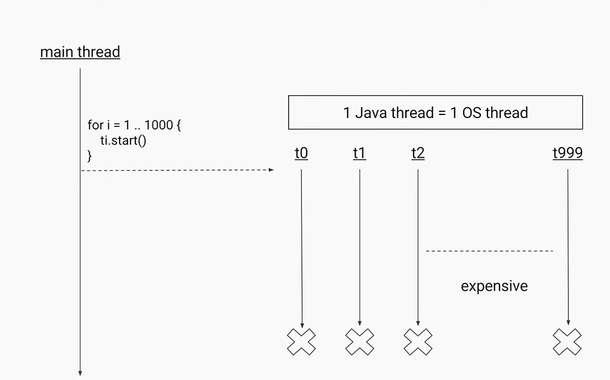
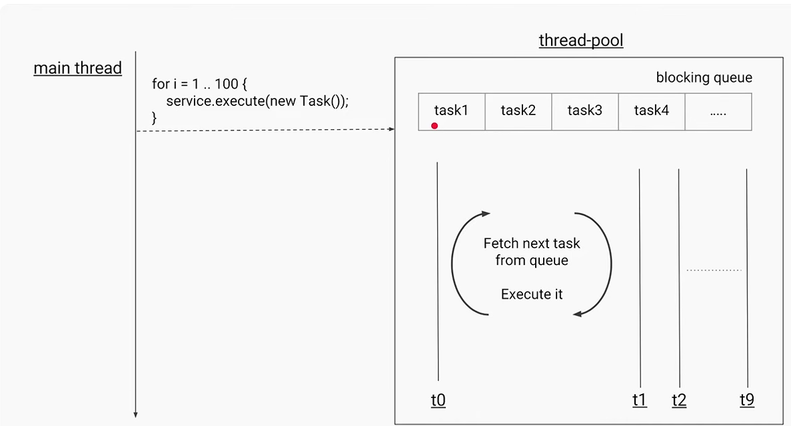
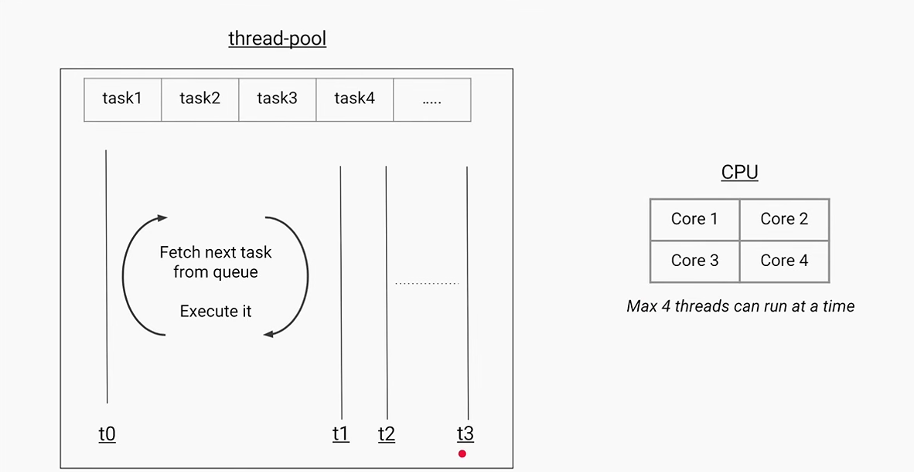

This is costly process since it involves creating and destroying threads, which can be expensive in terms of performance. Instead, using a thread pool allows for reusing threads, reducing the overhead of thread creation and destruction.
It is a good practice to use `ExecutorService` for managing threads in Java. It provides a higher-level replacement for working with threads directly, allowing for better resource management and easier handling of concurrent tasks.

Costly operations can be offloaded to a thread pool using `ExecutorService`. This allows the main thread to continue processing other requests while the expensive task runs in the background.

Thread pools can be created using `Executors.newFixedThreadPool(int nThreads)`, which creates a pool of a fixed number of threads. Tasks can be submitted to the pool using the `submit()` method, which returns a `Future` object that can be used to retrieve the result of the task once it is completed.

